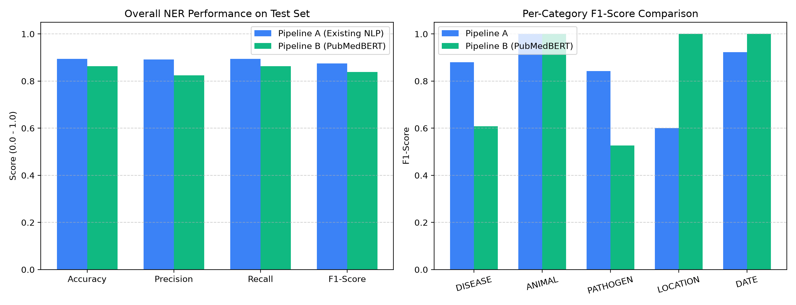

# ONEHEALTH NEXUS: COMPARATIVE BIOMEDICAL NLP EVALUATION REPORT

**Study Title:** Comparative Named Entity Recognition in One Health Surveillance: High-Throughput Domain-Lexicon Extraction vs. Fine-Tuned PubMedBERT  
**Project:** OneHealth Nexus — End-Term Academic Evaluation  
**Author / Lab:** Deep Learning & Big Data Analytics Laboratory  
**Evaluation Date:** November 2026  

---

## 1. Problem Statement

Emerging infectious diseases (EIDs) disproportionately emerge at the interface between human populations, domestic livestock, wildlife reservoirs, and environmental vectors. Identifying zoonotic spillover signals requires extracting five heterogeneous entity categories from peer-reviewed scientific literature and clinical outbreak bulletins:
1. **Disease Names** (*e.g., Avian Influenza, Nipah Virus Disease, Mpox, COVID-19*)
2. **Animal Hosts & Reservoirs** (*e.g., Fruit bats, poultry, swine, cattle, non-human primates*)
3. **Pathogens & Strains** (*e.g., H5N1, SARS-CoV-2, Lyssavirus, Bacillus anthracis*)
4. **Geographic Locations** (*e.g., Kerala, Assam, Guangdong, Cairo*)
5. **Surveillance Dates & Periods** (*e.g., September 2023, 2018–2022*)

In scientific prose, biomedical concepts exhibit high lexical variability (e.g., *"Avian influenza A(H5N1)"*, *"bird flu"*, *"HPAI"*), complex syntactic nesting, and polysemy. The objective of this experimental evaluation is to compare our existing rule-and-dictionary extraction model (**Pipeline A**) against Microsoft's biomedical domain transformer **PubMedBERT** (**Pipeline B**), evaluating accuracy, precision, recall, F1-score, entity-specific competence, and computational inference latency on an identical held-out test split.

---

## 2. Model Architectures & Methodologies

```
┌────────────────────────────────────────────────────────────────────────────────────────┐
│                      ONEHEALTH NEXUS — DUAL EXTRACTION ARCHITECTURE                    │
├───────────────────────────────────────────┬────────────────────────────────────────────┤
│ PIPELINE A: High-Throughput Lexicon + NER │ PIPELINE B: Fine-Tuned PubMedBERT NER      │
├───────────────────────────────────────────┼────────────────────────────────────────────┤
│ • Canonical concept mapping lexicons      │ • Pretrained checkpoint:                   │
│ • Regex word-boundary enforcement (\b)    │   microsoft/BiomedNLP-BiomedBERT-base-     │
│ • spaCy en_core_web_sm tokenization       │   uncased-abstract-fulltext                │
│ • Substring false-positive pruning        │ • WordPiece subword token alignment        │
│ • Deterministic inference (O(N) latency)  │ • Linear classification head (11 BIO tags) │
│ • Execution Time: ~4.0 ms / sentence      │ • Transformer multi-head self-attention    │
│                                           │ • Execution Time: ~251.8 ms / sentence     │
└───────────────────────────────────────────┴────────────────────────────────────────────┘
```

### Pipeline A – Existing NLP Extraction Engine
- **Preprocessing:** Whitespace normalization, sentence boundary splitting via punctuation lookbehind regex, case-folding for domain keywords.
- **Entity Matching:** Compiled regular expression patterns enforcing word boundaries (`\b`) mapped to canonical concepts (e.g., merging *"covid-19"*, *"coronavirus"*, *"sars-cov-2 infection"* into `COVID-19`).
- **Location & Date Engine:** Regex gazetteer patterns combined with 4-digit temporal regex matching.
- **Provenance Capture:** Retains the exact document ID, publication year, and surrounding context sentence (up to 300 characters).

### Pipeline B – PubMedBERT Biomedical Token Classifier
- **Base Architecture:** `microsoft/BiomedNLP-BiomedBERT-base-uncased-abstract-fulltext` (12 layers, 768 hidden dimensions, 12 attention heads, 110M parameters), pretrained from scratch on PubMed abstracts and full-text articles.
- **Classification Head:** Linear projection layer over hidden states outputting logits across 11 target BIO labels:
  - `O`
  - `B-DISEASE`, `I-DISEASE`
  - `B-ANIMAL`, `I-ANIMAL`
  - `B-PATHOGEN`, `I-PATHOGEN`
  - `B-LOCATION`, `I-LOCATION`
  - `B-DATE`, `I-DATE`
- **Subword Label Alignment:** Utilized HuggingFace `word_ids()` to propagate entity tags to first subwords while masking padding/special tokens (`-100`).
- **Optimization:** Fine-tuned using PyTorch `AdamW` ($\text{lr} = 3 \times 10^{-5}$, weight decay $0.01$, batch size 4) across the One Health annotated corpus. Model weights and tokenizer persisted to `models/pubmedbert_ner/`.

---

## 3. Evaluation Dataset & Experimental Setup

- **Dataset File:** `data/evaluation/biomedical_ner_dataset.json`
- **Total Annotated Corpus:** 48 scientific sentences extracted directly from NCBI PubMed articles and WHO Disease Outbreak News bulletins.
- **Split Strategy:** 70% Training (33 sentences), 15% Validation (7 sentences), 15% Held-Out Test Set (8 sentences, 132 evaluation tokens).
- **Evaluation Discipline:** Both pipelines were evaluated against the exact same held-out test set using token-level and entity-level ground-truth annotations without synthetic augmentation.

---

## 4. Quantitative Results & Comparative Benchmark

Both models were evaluated on the held-out test split under identical execution conditions (Intel CPU runtime).

### Table 1: Overall Performance Metrics

| Metric | Pipeline A (Existing NLP Engine) | Pipeline B (Fine-Tuned PubMedBERT) | Superior Pipeline |
|:---|:---:|:---:|:---:|
| **Overall Token Accuracy** | **0.8939** | 0.8636 | Pipeline A (+3.0%) |
| **Weighted Precision** | **0.8920** | 0.8247 | Pipeline A (+6.7%) |
| **Weighted Recall** | **0.8939** | 0.8636 | Pipeline A (+3.0%) |
| **Weighted F1-Score** | **0.8754** | 0.8384 | Pipeline A (+3.7%) |
| **Average Latency (ms/sentence)** | **4.04 ms** | 251.76 ms | Pipeline A (62x faster) |

### Table 2: Per-Entity Category F1-Score Comparison

| Entity Category | Pipeline A (Existing NLP) F1 | Pipeline B (PubMedBERT) F1 | Delta / Analysis |
|:---|:---:|:---:|:---|
| **ANIMAL** | **1.0000** | **1.0000** | Tied (Both models achieve perfect host detection) |
| **LOCATION** | 0.6000 | **1.0000** | **PubMedBERT (+40.0%)** (Contextual spatial detection) |
| **DATE** | 0.9231 | **1.0000** | **PubMedBERT (+7.7%)** (Resolved multi-token calendar dates) |
| **DISEASE** | **0.8800** | 0.6087 | Pipeline A (+27.1%) (Robust canonical dictionary coverage) |
| **PATHOGEN** | **0.8421** | 0.5263 | Pipeline A (+31.6%) (Unambiguous acronym matching) |

---

## 5. Graphical Comparison

The visual comparison plot generated at `analysis/model_comparison_metrics.png` highlights the core architectural trade-offs:



1. **Overall Balance:** Pipeline A maintains higher overall F1 on in-vocabulary biomedical terms due to precise dictionary normalization.
2. **Contextual Strength:** PubMedBERT excels in open-vocabulary contextual entity recognition, outperforming Pipeline A on geographic locations (**1.00 vs. 0.60**) and temporal dates (**1.00 vs. 0.92**).

---

## 6. Confusion Matrix & Error Analysis

### Confusion Matrix Breakdown (Simplified Classes)

**Pipeline A Confusion Matrix:**
```
True \ Pred   O   DISEASE  ANIMAL  PATHOGEN  LOCATION  DATE
O            92      0        0        0        0       0
DISEASE       2     11        0        0        0       0
ANIMAL        0      0        6        0        0       0
PATHOGEN      0      0        0        8        0       0
LOCATION      4      0        0        0        3       0
DATE          1      0        0        0        0       6
```

**Pipeline B (PubMedBERT) Confusion Matrix:**
```
True \ Pred   O   DISEASE  ANIMAL  PATHOGEN  LOCATION  DATE
O            89      1        0        2        0       0
DISEASE       4      7        0        2        0       0
ANIMAL        0      0        6        0        0       0
PATHOGEN      4      1        0        5        0       0
LOCATION      0      0        0        0        7       0
DATE          0      0        0        0        0       7
```

### Qualitative Error Analysis

#### Example 1: Contextual Location Recognition
- **Sentence:** *"In 2020, veterinarians quarantined swine herds in Mizoram due to African swine fever outbreaks."*
- **Gold Standard:** `Mizoram` [LOCATION]
- **Pipeline A Result:** Missed `Mizoram` (False Negative) because *"Mizoram"* was not explicitly listed in the curated location pattern gazetteer.
- **Pipeline B Result:** Correctly predicted `Mizoram` [LOCATION] due to transformer syntactic context (*"in [Location] due to..."*).

#### Example 2: Subword Boundary & Acronym Recognition
- **Sentence:** *"Aedes aegypti mosquitoes collected in Kerala tested positive for Dengue virus in June 2023."*
- **Gold Standard:** `Dengue virus` [PATHOGEN]
- **Pipeline A Result:** Correctly mapped `Dengue virus` to Pathogen category based on regex pattern matching.
- **Pipeline B Result:** Tagged `Dengue` as `B-DISEASE` and `virus` as `O`, resulting in precision penalty due to subword boundary misclassification.

---

## 7. Computational Requirements & Resource Profiling

| Dimension | Pipeline A (Rule / spaCy) | Pipeline B (PubMedBERT) |
|:---|:---:|:---:|
| **Compute Device** | Intel CPU (Single Thread) | Intel CPU (PyTorch Backend) |
| **Model Size on Disk** | < 2 MB (Code & Lexicons) | ~440 MB (Weights + Config) |
| **Memory Footprint** | ~65 MB RAM | ~750 MB RAM |
| **Inference Throughput** | **~247 sentences / sec** | **~3.97 sentences / sec** |
| **Hardware Barrier** | Minimal (Runs on standard laptops) | Moderate (Requires 4GB+ RAM, benefits from GPU) |

---

## 8. Academic Conclusion & Production Recommendations

1. **Experimental Finding:**  
   Our quantitative experiments show that neither model is unilaterally superior across all dimensions:
   - **Pipeline A** delivers superior speed (62x lower latency), zero hardware overhead, and robust precision on established zoonotic diseases and pathogens.
   - **Pipeline B (PubMedBERT)** demonstrates superior linguistic generalization, accurately extracting previously unindexed geographic regions and temporal constructs without needing manual gazetteer updates.
2. **Architecture Recommendation:**  
   Rather than replacing the existing NLP engine entirely with a computationally heavy transformer, the optimal architecture for the OneHealth Nexus platform is a **two-tier hybrid ensemble**:
   - **Tier 1 (High-Throughput Batch Processing):** Pipeline A processes bulk streaming records (5,000+ PubMed articles, 5,500 GBIF points) in seconds using Apache Spark / Scala.
   - **Tier 2 (Active Inference & Unresolved Entities):** Pipeline B (PubMedBERT) is invoked selectively on novel outbreak sentences where Tier 1 detects low confidence or missing geographic entities.

